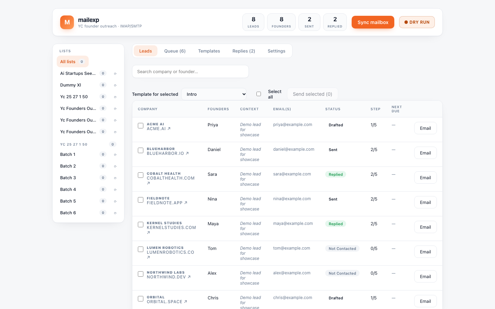

# mailexp

A personal outreach tool for sending personalized mass emails from a spreadsheet.

Upload a `.xlsx` file of companies, founders, and email addresses, and mailexp turns it into a manageable outreach list. It builds personalized drafts from templates, queues them with rate limits, sends through your own mailbox, and tracks replies and follow-ups.



## What it does

- **Import from Excel** — drop `.xlsx` files into the `xls/` folder and import them as lead lists.
- **Personalized templates** — use placeholders like `{{company}}` and `{{names}}` to personalize each email.
- **Mass email with guardrails** — queue selected leads, set a daily cap and send interval, and track every message.
- **Dry-run mode** — preview and stage emails without actually sending them.
- **Reply tracking** — sync your inbox over IMAP to match replies back to leads.
- **Follow-up sequences** — track steps, due dates, and status for each lead.

## Tech stack

- **Backend:** FastAPI, SQLite, openpyxl
- **Frontend:** React + Vite
- **Email:** SMTP for sending, IMAP for reply sync

## Running locally

```bash
python -m venv .venv
source .venv/bin/activate
pip install -r requirements.txt

cp .env.example .env   # add your Gmail app password
mkdir -p xls           # put your .xlsx lead files here

uvicorn app.main:app --reload
```

In a second terminal:

```bash
cd web
npm install
npm run dev
```

Then open `http://localhost:5173`.

> This project is a personal showcase. It is not deployed publicly.
